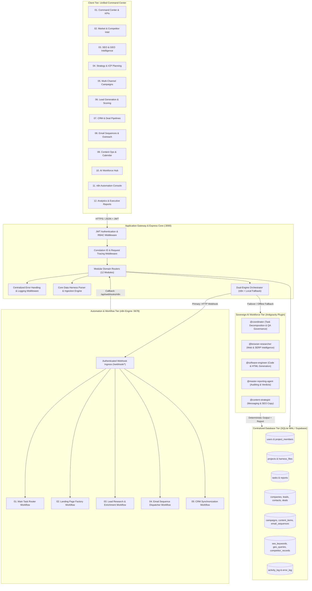
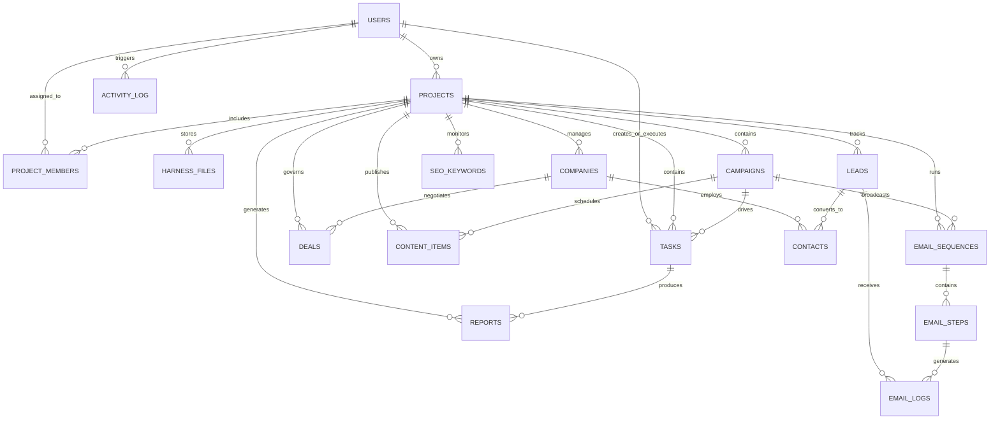
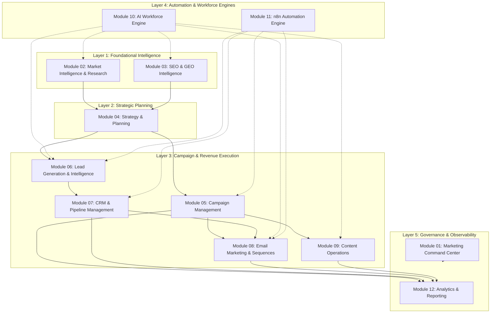
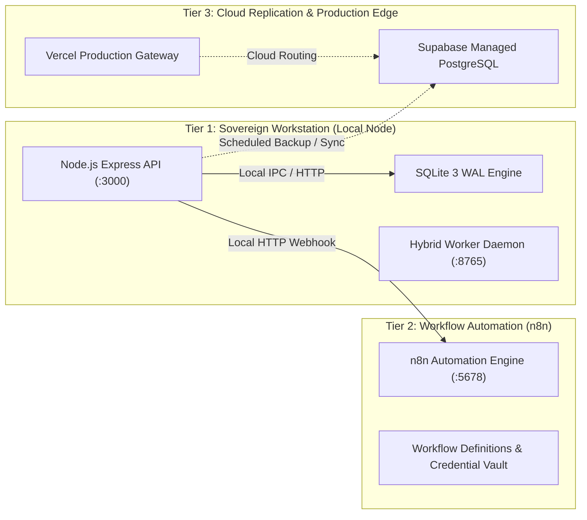
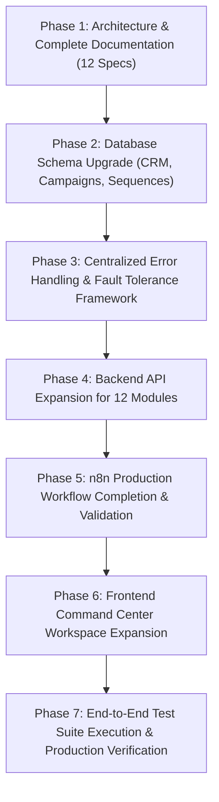

# System Architecture — AI-Powered Marketing Operating System

**Document Version:** 2.0.0  
**Target Release:** Marketing OS v2.0 Enterprise  
**Author:** Principal Software Architect & CTO  
**Date:** 2026-11-16  

---

## 1. Executive Overview

The **AI-Powered Marketing Operating System (Marketing OS)** is a unified, production-ready enterprise platform that automates, governs, and optimizes the complete marketing lifecycle:
$$\text{Research} \longrightarrow \text{Intelligence} \longrightarrow \text{Strategy} \longrightarrow \text{Planning} \longrightarrow \text{Execution} \longrightarrow \text{Automation} \longrightarrow \text{Measurement} \longrightarrow \text{Optimization}$$

The system operates across three synchronized execution tiers:
1. **Unified Command Center:** Responsive, accessible web application serving 12 specialized operational modules.
2. **Dual-Engine Execution Tier:** Bidirectional n8n visual automation workflows coupled with a resilient local AI agent fallback squad.
3. **Sovereign Relational Data Foundation:** High-performance SQLite engine operating in WAL mode with strict foreign key constraints and audit logging.

---

## 2. System Architecture Diagram



---

## 3. Database Entity Relationship Diagram (ERD)



---

## 4. Module Dependency Map

The 12 system modules are structured into clear hierarchical layers:



---

## 5. Security & Isolation Architecture

1. **Role-Based Access Control (RBAC):**
   - `super_admin`: Global platform configuration, user provisioning, database maintenance.
   - `admin`: Full project lifecycle, task creation, delivery approvals (Gate G2), campaign management.
   - `manager`: Project creation, squad assignments, review and edits.
   - `member`: Task execution, data inspection, drafting deliverables. (Blocked from final delivery via HTTP 403).
   - `client`: External stakeholder view; strictly restricted to `delivered` deliverables for assigned projects.
2. **Outbound Approval Gate G2:**
   - Real email dispatch, external CMS publishing, and paid advertising operations cannot occur automatically.
   - The engine generates a `DRY-RUN / STAGING RECEIPT` and transitions the task to `in_review`.
   - Dispatch executes only when an authorized operator clicks **Approve & Deliver** or issues an approved token.
3. **Secrets Management:**
   - External credentials (API keys, SMTP passwords) are encrypted using AES-256 in the vault.
   - Raw credentials are never transmitted over unencrypted channels or displayed in public logs.
4. **Network & CORS Protection:**
   - CORS is restricted to explicit trusted origins: `http://localhost:3000`, `http://127.0.0.1:3000`, and authorized staging/production domains.

---

## 6. Error Handling & Fault Tolerance Architecture

Adhering strictly to the **Global Engineering Rule**:

1. **Centralized Error Hierarchy (`server/errors.js`):**
   - `AppError` base class with `statusCode`, `category`, `code`, `isOperational`, and `correlationId`.
   - Specific subclasses: `ValidationError`, `AuthenticationError`, `AuthorizationError`, `NotFoundError`, `ConflictError`, `ExternalServiceError`, `DatabaseError`, `TimeoutError`.
2. **Defensive Try/Catch/Finally Enforcement:**
   - Every database query, API route, file upload, n8n webhook, and AI agent execution is wrapped in defensive try/catch blocks.
   - Database operations execute inside atomic SQLite transactions (`db.transaction()`) with automatic rollback on error.
   - Server errors preserve the full stack trace in `error_log` while returning a clean, sanitized JSON envelope to the client:
     ```json
     {
       "error": {
         "code": "VALIDATION_ERROR",
         "category": "VALIDATION_ERROR",
         "message": "Invalid email address format.",
         "correlation_id": "req-98421-c7",
         "timestamp": "2026-11-16T05:22:00Z"
       }
     }
     ```
3. **Resilient Dual-Engine Failover:**
   - When n8n is offline or unreachable, the system automatically routes tasks to the local Antigravity agent runner (`server/localRunner.js`) without dropping the task or crashing the process.

---

## 7. Deployment & Infrastructure Architecture



---

## 8. Implementation Roadmap


