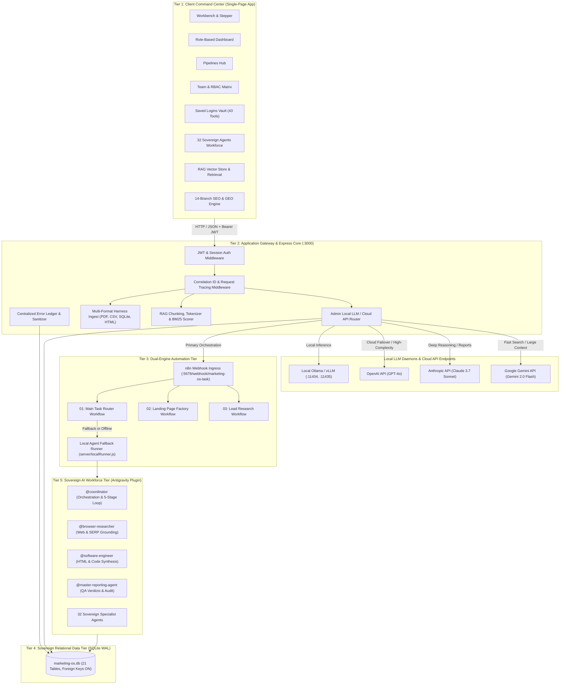
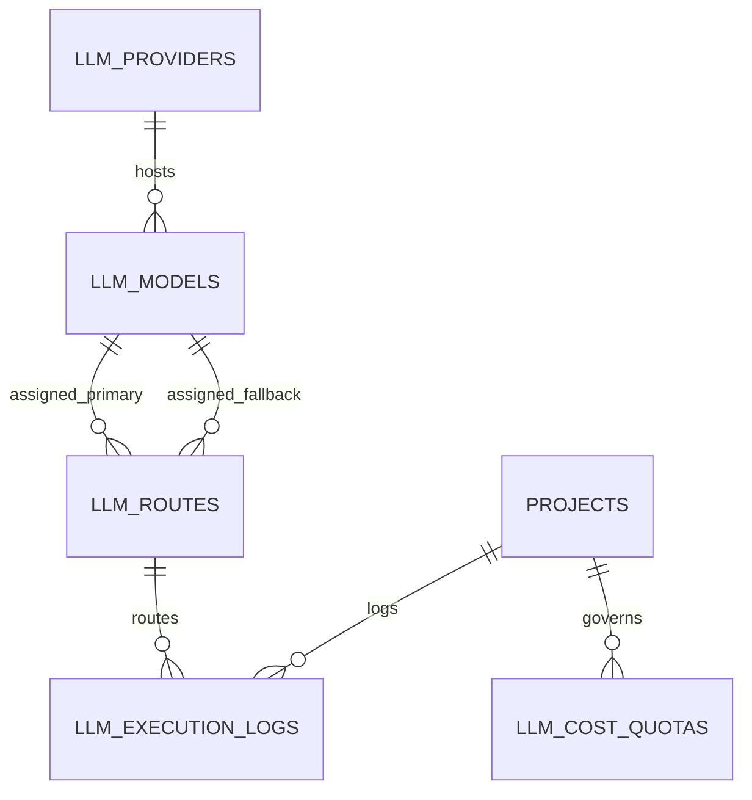
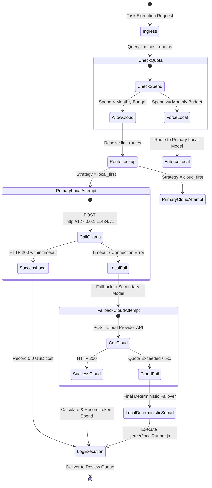

# SYSTEM FULL-STACK BLUEPRINT & COMPREHENSIVE ARCHITECTURAL AUDIT
**AI-Powered Marketing Operating System (Marketing OS v2.1 Enterprise)**
**Author:** Lead Systems Architect & Deep Audit Taskforce  
**Date:** 2026-11-16  
**Status:** Approved Architectural Blueprint & Baseline Audit  

---

## 1. Executive Summary & Platform Overview

The **Marketing Operating System (Marketing OS)** is an autonomous, full-lifecycle marketing factory built to orchestrate, execute, verify, and deliver enterprise marketing campaigns across 12 operational domains:
$$\text{Intelligence} \longrightarrow \text{Strategy} \longrightarrow \text{Content} \longrightarrow \text{SEO/GEO} \longrightarrow \text{Campaigns} \longrightarrow \text{Leads} \longrightarrow \text{CRM} \longrightarrow \text{Outreach} \longrightarrow \text{Governance}$$

### Core Operating Tenets
1. **100% Grounded Execution:** All deliverables, facts, pricing claims, and competitive teardowns must originate from verified user harness files uploaded to `/uploads`. Hallucination tolerance is strictly 0%.
2. **Dual-Engine Resilience:** High-throughput visual orchestration runs on an external n8n automation engine (`:5678`). When n8n is offline, unreachable, or times out (10s threshold), tasks automatically fail over to an internal local AI agent runner (`server/localRunner.js`) without crashing or dropping jobs.
3. **Approval Gate G2 (Human-in-the-Loop Consent):** No outbound email, published CMS page, or live advertising campaign is dispatched automatically. The engine generates a `DRY-RUN / STAGING RECEIPT` in state `in_review`. Live dispatch requires explicit approval by an operator holding `admin` or `super_admin` privileges.
4. **Sovereign Multi-Tenancy & RBAC:** Complete data plane isolation across 5 roles (`super_admin`, `admin`, `manager`, `member`, `client`) backed by SQLite WAL mode and foreign key integrity.

---

## 2. High-Level System Architecture & Flow Topology



---

## 3. Tier 1: Client Command Center Architecture

The frontend is a zero-build, responsive Single-Page Application (SPA) driven by Tailwind CSS 3.4, Geist Mono typography, and an event-driven DOM engine.

### 3.1 Primary Views
1. **Workbench (`view-workbench`):** Main interactive execution studio. Houses the project switcher, 8 pipeline selectors, 5-stage visual stepper (Plan $\rightarrow$ Assign $\rightarrow$ Execute $\rightarrow$ Verify $\rightarrow$ Report), live HTML iframe output viewport, telemetry logs, and QA Verdict panel.
2. **Role Dashboard (`view-roleDash`):** Dynamic overview presenting live system metrics (Delivered, In Review, Running, Total Projects) with strict multi-tenant filtering.
3. **Pipelines Console (`view-pipelines`):** Visual architecture of all 8 core pipelines displaying assigned agent squads, execution SLA, input requirements, and output schemas.
4. **Team & RBAC Matrix (`view-team`):** User management console displaying active operators, RBAC privileges, department alignments, and project membership boundaries.
5. **Saved Logins Vault (`view-logins`):** Enterprise credential registry managing 43 external marketing tools (Hostinger, Google Workspace, Surfer SEO, Semrush, Hunter.io, OpenAI, etc.). Includes one-click credential reveal for Admins, live latency testing, and category filters.
6. **32 Sovereign Agents Hub (`view-agents`):** Sovereign workforce catalog grouping 32 agents across 8 departments (Leadership, Research, Engineering, Design, Ops, Growth, Finance, Legal) with interactive dispatch modals.
7. **RAG Vector Store (`view-rag`):** Project-scoped semantic document retrieval workbench. Enables real-time document chunking, overlap inspection, and BM25-weighted semantic search.
8. **14-Branch SEO & GEO Engine (`view-seo`):** Interactive hierarchy of 14 SEO/GEO disciplines with tool integrations and one-click execution triggers.

### 3.2 Modal Subsystem
- **Modal 1 (New Project Modal):** Form collecting client name, project goal, and campaign type.
- **Modal 2 (Harness Upload Modal):** Drag-and-drop file ingestion zone with automatic category tagging.
- **Modal 3 (Inspect Deliverable Modal):** Fullscreen JSON/HTML asset viewer.
- **Modal 4 (Admin Report Markdown Modal):** Standardized executive report inspector showing QA verdicts.
- **Modal 5 (Guidelines & Custom Rules Modal):** Markdown editor for project-level SOPs and custom squad directives.
- **Modal 6 (MCP Hub + Offline LLM Modal):** Antigravity `mcp_config.json` snippet and Python SDK local agent config.
- **Modal 7 (Auth Credentials Switcher):** Role switching and JWT authentication modal.
- **Modal 8 (SEO Subcategory Detail Modal):** Tool requirements and workflow prompt inspector.
- **Modal 9 (Agent Dispatch Modal):** Interactive task dispatcher mapping brief and priority to any of the 32 sovereign agents.

---

## 4. Tier 2: Application Gateway & Express Core Architecture

The backend gateway runs on Express 4.19 with Better-SQLite3, providing REST endpoints, middleware governance, error logging, and asynchronous task scheduling.

### 4.1 Middleware Chain
```
Request Ingress
  │
  ├── 1. cors({ origin: trustedOrigins }) ── Prevent unauthorized cross-origin requests
  ├── 2. express.json({ limit: '10mb' }) ── Parse JSON payloads
  ├── 3. express.urlencoded({ extended: true }) ── Parse form data
  ├── 4. correlationMiddleware ── Inject/propagate X-Correlation-ID
  ├── 5. authMiddleware ── Verify Bearer JWT (with dev/session fallbacks)
  ├── 6. requireRole(...roles) ── Enforce RBAC permissions
  ├── 7. canAccessProject(user, projectId) ── Enforce multi-tenant project boundary
  │
  ▼
Domain Handler / Controller (asyncHandler wrapped)
  │
  ▼
Centralized errorHandler (server/errors.js) ── Logs to SQLite error_log, returns sanitized JSON
```

### 4.2 Multi-Format Core Data Harness Parser
The harness parser (`server/index.js:76`) classifies incoming uploads into 8 deterministic categories:
- `.db, .sqlite, .sqlite3, .sql` $\rightarrow$ **Core Database**
- `.html, .htm` $\rightarrow$ **HTML Prototype**
- `.png, .jpg, .jpeg, .webp, .svg` $\rightarrow$ **Image Asset**
- `.pdf, .doc, .docx` $\rightarrow$ **Document**
- `.csv, .xlsx, .xls, .tsv` $\rightarrow$ **Spreadsheet**
- `.zip, .tar, .gz, .tgz, .7z` $\rightarrow$ **Archive Bundle**
- `.md, .markdown, .txt, .sop` $\rightarrow$ **Workflow SOP & Guidelines**
- `.json, .jsonld` $\rightarrow$ **Core Database**

All text-based files (`.txt, .md, .csv, .html, .json, .sql`) are automatically chunked and indexed into `rag_chunks` for real-time semantic retrieval.

---

## 5. Tier 3: Dual-Engine Automation Tier

### 5.1 Primary Engine: n8n Visual Automation Workflows
Located in `n8n-workflows/`:
1. `01-main-task-router.json`: Webhook ingress (`/webhook/marketing-os-task`) $\rightarrow$ Switch by pipeline $\rightarrow$ Local Ollama / LLM node $\rightarrow$ Callback to `/api/webhooks/n8n`.
2. `02-landing-page-factory.json`: HTML compiler and Tailwind CSS synthesizer with deterministic fallback layout.
3. `03-lead-research.json`: Lead extraction and ICP qualification pipeline scoring accounts 0–100.

### 5.2 Secondary Engine: Local Antigravity Fallback Runner
Implemented in `server/localRunner.js`:
- Executes synchronously if n8n times out after 10,000ms or returns connection errors (`ECONNREFUSED`, `ENOTFOUND`, `AbortError`).
- Ingests grounded harness data (e.g. `Priority_A_Outreach_Email_Merge_Fields.csv`).
- Produces deterministic structured output (`output_json`) and standardized Admin Report (`report_md`).
- Flags unverified assertions with `"Not in harness"` and transitions task to `in_review`.

---

## 6. Tier 4: Sovereign Relational Data Tier (SQLite WAL Mode)

Database connection configuration:
```sql
PRAGMA journal_mode = WAL;
PRAGMA foreign_keys = ON;
PRAGMA synchronous = NORMAL;
```

### 6.1 Current Production Table Matrix (21 Tables)
1. `users`: RBAC identity, password hashes, departments, status.
2. `projects`: Isolated workspace boundaries, client goals, progress metrics.
3. `project_members`: User-to-project mappings with project-specific roles.
4. `tasks`: Execution DAG, pipeline identifier, harness bindings, input/output JSON, status.
5. `harness_files`: Ground truth uploaded assets with file category and summaries.
6. `reports`: Executive verification reports with QA verdicts (`pending`, `approved`, `needs_fix`).
7. `campaigns`: Multi-channel marketing campaigns with budget and spend tracking.
8. `companies`: Target account firmographics and grounded facts.
9. `leads`: Prospect contacts with ICP qualification scores and source evidence.
10. `deals`: Sales pipeline deals linked to companies and leads with stage probabilities.
11. `email_sequences`: Automated multi-step nurture sequences.
12. `email_steps`: Individual steps within sequences with Gate G2 flags.
13. `email_logs`: Staging receipts and live provider dispatch receipts.
14. `content_items`: Editorial calendar assets across blog, social, ad, and video formats.
15. `seo_keywords`: Search queries with volume, difficulty, rank, and intent.
16. `geo_queries`: Generative Engine Optimization prompts tracked across ChatGPT, Gemini, Perplexity.
17. `activity`: Operational audit trail logging user and agent actions.
18. `error_log`: Structured error and incident ledger with correlation IDs.
19. `vault_items`: Encrypted credentials and API keys.
20. `saved_logins`: Tool credential vault for 43 external marketing platforms.
21. `rag_chunks`: Overlap text chunks, token counts, keywords, and embeddings for semantic search.

---

## 7. Tier 5: Sovereign AI Workforce Tier (32 Agents across 8 Squads)

Marketing OS registers 32 autonomous sovereign agents across 8 departments:

| Squad | Lead Agent | Specialist Agents | Primary Operational Responsibilities |
|:------|:-----------|:------------------|:--------------------------------------|
| **1. Leadership** | `@coordinator` | `@strategist`, `@chief-staff`, `@vision-keeper` | 5-stage loop governance, task decomposition, OKR mapping, brand voice |
| **2. Research** | `@browser-researcher` | `@data-miner`, `@competitor-analyst`, `@audience-profiler` | SERP intelligence, web scraping, harness synthesis, ICP scoring |
| **3. Engineering** | `@software-engineer` | `@frontend-dev`, `@automation-architect`, `@qa-tester` | HTML/Tailwind synthesis, n8n webhook engineering, code validation |
| **4. Design & Creative** | `@creative-director` | `@copywriter`, `@ui-designer`, `@motion-designer` | Brand identity, ad copy variants, responsive layouts, media briefs |
| **5. Operations** | `@ops-director` | `@workflow-specialist`, `@database-admin`, `@integrations-engineer` | SQLite WAL maintenance, credential vaulting, API connectivity |
| **6. Growth & Marketing** | `@growth-lead` | `@seo-strategist`, `@outreach-specialist`, `@campaign-manager` | 14-branch SEO/GEO engine, cold email sequences, paid search/social |
| **7. Finance & Monetization** | `@finance-lead` | `@pricing-analyst`, `@unit-economics`, `@budget-controller` | Spend vs budget reconciliation, CAC/LTV modeling, deal margins |
| **8. Legal & Compliance** | `@sentry` | `@privacy-counsel`, `@terms-analyst`, `@brand-protection` | Gate G2 human consent enforcement, CASL/GDPR/PIPEDA compliance |

### The 5-Stage Agent Execution Loop
$$\text{Stage 1: Policy \& Brief} \longrightarrow \text{Stage 2: Think \& Plan} \longrightarrow \text{Stage 3: Act \& Synthesize} \longrightarrow \text{Stage 4: Observe \& Verify} \longrightarrow \text{Stage 5: Report \& Verdict}$$

---

## 8. Deep Dive: The 12 Operational Marketing Modules

### Module 01: Marketing Command Center
- **Role:** Unified executive dashboard displaying live platform KPIs, active campaigns, pending reviews, running engines, and real-time activity feeds.
- **Squad:** `@coordinator`, `@chief-staff`, `@master-reporting-agent`.
- **Database Tables:** `projects`, `tasks`, `reports`, `activity`, `error_log`.
- **REST Endpoints:** `GET /api/dashboard`, `GET /api/activity`, `GET /api/health`.
- **Failure Modes & Fallback:** DB lock degrades to cached snapshot; displays offline network indicator.

### Module 02: Market Intelligence & Research
- **Role:** Competitive teardowns, market whitespace analysis, and pain-point extraction from harness files.
- **Squad:** `@browser-researcher`, `@competitor-analyst`, `@coordinator`.
- **Pipeline Identifier:** `market-intel`.
- **REST Endpoints:** `POST /api/projects/:id/tasks` (`pipeline: market-intel`), `POST /api/tasks/:id/run`.
- **Data Contract:** Ingests competitor domains and focus areas; outputs verified pricing comparison, whitespace matrix, and SWOT report.

### Module 03: SEO & GEO Intelligence
- **Role:** 14-branch search optimization covering SERP keyword clusters, Generative Engine Optimization (GEO) citations across ChatGPT/Gemini/Perplexity, and schema markup.
- **Squad:** `@seo-strategist`, `@browser-researcher`, `@software-engineer`.
- **Pipeline Identifier:** `content-seo`.
- **REST Endpoints:** `GET /api/seo/tree`, `POST /api/seo/execute`, `GET /api/projects/:id/seo-keywords`, `POST /api/projects/:id/seo-keywords`.
- **Data Contract:** Ingests topic and domain; outputs keyword difficulty matrix, JSON-LD schema, and LLM citation prompts.

### Module 04: Marketing Strategy & ICP Planning
- **Role:** Formulates Ideal Customer Profiles (ICPs), buyer personas, brand kits, and value propositions.
- **Squad:** `@strategist`, `@audience-profiler`, `@vision-keeper`.
- **Pipeline Identifier:** `brand-kit`.
- **REST Endpoints:** `POST /api/projects/:id/tasks` (`pipeline: brand-kit`), `GET /api/projects/:id/guidelines`, `PUT /api/projects/:id/guidelines`.
- **Data Contract:** Outputs ICP matrix, primary color tokens, typography rules, and voice guidelines.

### Module 05: Multi-Channel Campaigns
- **Role:** Orchestrates marketing campaigns across Search, Social, Email, and Content with spend tracking.
- **Squad:** `@campaign-manager`, `@growth-lead`, `@coordinator`.
- **Database Tables:** `campaigns`.
- **REST Endpoints:** `GET /api/projects/:id/campaigns`, `POST /api/projects/:id/campaigns`, `PATCH /api/campaigns/:id`.
- **Data Contract:** Input: `{ name, objective, channels, budget }`. Output: Persisted campaign with live spend calculation.

### Module 06: Lead Generation & Scoring
- **Role:** Enriches target account profiles, scores leads 0–100 against ICP firmographics, and detects duplicate records.
- **Squad:** `@data-miner`, `@browser-researcher`, `@outreach-specialist`.
- **Pipeline Identifier:** `lead-research`.
- **Database Tables:** `companies`, `leads`.
- **REST Endpoints:** `GET /api/projects/:id/companies`, `POST /api/projects/:id/companies`, `GET /api/projects/:id/leads`, `POST /api/projects/:id/leads`.
- **Data Contract:** Validates email syntax and records source verification evidence.

### Module 07: CRM & Deal Pipelines
- **Role:** Visual revenue pipeline managing companies, contacts, deals, and stages (`lead`, `discovery`, `demo`, `proposal`, `negotiation`, `closed_won`, `closed_lost`).
- **Squad:** `@growth-lead`, `@ops-director`.
- **Database Tables:** `deals`, `companies`, `leads`.
- **REST Endpoints:** `GET /api/projects/:id/deals`, `POST /api/projects/:id/deals`, `PATCH /api/deals/:id`.
- **Data Contract:** Computes weighted pipeline revenue: $\sum (\text{deal\_value} \times \text{probability})$.

### Module 08: Email Sequences & Outreach (Gate G2 Enforcement)
- **Role:** Authors and stages 5-step automated nurture sequences with CASL/CAN-SPAM compliance.
- **Squad:** `@outreach-specialist`, `@copywriter`, `@sentry`.
- **Pipeline Identifier:** `email-campaign`.
- **Database Tables:** `email_sequences`, `email_steps`, `email_logs`.
- **REST Endpoints:** `GET /api/projects/:id/email-sequences`, `POST /api/projects/:id/email-sequences`, `POST /api/email-sequences/:id/dispatch-test`.
- **Gate G2 Policy:** Outbound dispatch without `approved: true` generates a `G2_HUMAN_CONSENT_REQUIRED` staging receipt. Live dispatch requires admin approval.

### Module 09: Content Operations & Editorial Calendar
- **Role:** Editorial calendar managing Blog posts, LinkedIn authority posts, X threads, and ad creative variants.
- **Squad:** `@copywriter`, `@creative-director`, `@coordinator`.
- **Pipeline Identifiers:** `content-seo`, `social-content`, `ads-creative`.
- **Database Tables:** `content_items`.
- **REST Endpoints:** `GET /api/projects/:id/content`, `POST /api/projects/:id/content`.
- **Data Contract:** Validates character limits for Google Ads and generates 7-day social authority calendars.

### Module 10: AI Workforce Engine
- **Role:** Manages the registry, role permissions, and interactive dispatching of all 32 sovereign agents.
- **Squad:** Full 32-agent workforce.
- **REST Endpoints:** `GET /api/agents`, `POST /api/agents/dispatch`.
- **Data Contract:** Receives agent slug, brief, and priority; outputs structured deliverable and Admin Report.

### Module 11: n8n Automation Engine
- **Role:** Visual workflow orchestration, webhook triggers, and automated cron sidecars.
- **Squad:** `@automation-architect`, `@integrations-engineer`.
- **Workflows:** `01-main-task-router`, `02-landing-page-factory`, `03-lead-research`.
- **REST Endpoints:** `POST /api/webhooks/n8n`.
- **Data Contract:** Authenticates via `x-os-api-key`; updates task status to `in_review` on completion.

### Module 12: Analytics & Executive Reporting
- **Role:** Consolidates conversion funnels, agent telemetry, task completion velocity, and multi-format reports.
- **Squad:** `@master-reporting-agent`, `@finance-lead`, `@coordinator`.
- **Database Tables:** `reports`, `tasks`, `error_log`, `activity`.
- **REST Endpoints:** `GET /api/projects/:id/reports`, `GET /api/reports/:id`.
- **Data Contract:** Enforces session token authentication for report downloads.

---

## 9. Admin Local LLM / Cloud API Routing Engine Architecture

### 9.1 Architectural Need & Objectives
Currently, Marketing OS relies on hardcoded Ollama endpoints (`http://127.0.0.1:11434/api/generate` with `llama3`) in n8n workflows, while `localRunner.js` performs deterministic string templating. There is no unified database-backed routing layer that allows administrators to:
1. Dynamically configure local LLM engines (Ollama, vLLM, LMStudio) vs cloud APIs (OpenAI, Anthropic, Gemini, Groq, DeepSeek).
2. Establish intelligent routing rules per marketing pipeline (e.g., Code/Landing Page $\rightarrow$ `qwen2.5-coder:32b` local-first; Deep Reasoning $\rightarrow$ `claude-3-7-sonnet` cloud-fallback).
3. Monitor token usage, latency, and spend quotas with automatic failover to local zero-cost models when budgets are exceeded.

### 9.2 Routing Engine Entity-Relationship Diagram



### 9.3 Exact SQLite Schema DDL

```sql
-- =============================================================================
-- ADMIN LOCAL LLM / CLOUD API ROUTING ENGINE SCHEMA
-- =============================================================================

-- 1. LLM Providers (Local engines and external cloud vendors)
CREATE TABLE IF NOT EXISTS llm_providers (
  id TEXT PRIMARY KEY,
  name TEXT NOT NULL,                                  -- e.g. 'Ollama Local Daemon', 'OpenAI Cloud'
  slug TEXT UNIQUE NOT NULL,                           -- e.g. 'ollama-local', 'openai-cloud'
  provider_type TEXT NOT NULL CHECK(provider_type IN ('local', 'cloud', 'hybrid')),
  base_url TEXT NOT NULL,                              -- e.g. 'http://127.0.0.1:11434/v1', 'https://api.openai.com/v1'
  api_key_vault_id TEXT,                               -- REFERENCES vault_items(id)
  is_active BOOLEAN DEFAULT 1,
  health_status TEXT DEFAULT 'unknown' CHECK(health_status IN ('online', 'degraded', 'offline', 'unknown')),
  latency_ms INTEGER DEFAULT 0,
  last_health_check DATETIME,
  max_concurrency INTEGER DEFAULT 4,
  config_json TEXT DEFAULT '{}',                       -- Additional headers, proxy config
  created_at DATETIME DEFAULT CURRENT_TIMESTAMP,
  updated_at DATETIME DEFAULT CURRENT_TIMESTAMP,
  FOREIGN KEY(api_key_vault_id) REFERENCES vault_items(id) ON DELETE SET NULL
);

-- 2. LLM Models Registry
CREATE TABLE IF NOT EXISTS llm_models (
  id TEXT PRIMARY KEY,
  provider_id TEXT NOT NULL,
  model_id TEXT NOT NULL,                              -- e.g. 'qwen2.5-coder:32b', 'gpt-4o', 'claude-3-7-sonnet'
  display_name TEXT NOT NULL,
  model_type TEXT NOT NULL CHECK(model_type IN ('chat', 'completion', 'embedding', 'vision', 'reasoning')),
  context_window INTEGER DEFAULT 8192,
  max_output_tokens INTEGER DEFAULT 4096,
  cost_per_million_input REAL DEFAULT 0.0,             -- USD per 1M tokens (0.0 for local)
  cost_per_million_output REAL DEFAULT 0.0,            -- USD per 1M tokens (0.0 for local)
  supports_tools BOOLEAN DEFAULT 1,
  supports_vision BOOLEAN DEFAULT 0,
  supports_streaming BOOLEAN DEFAULT 1,
  is_enabled BOOLEAN DEFAULT 1,
  created_at DATETIME DEFAULT CURRENT_TIMESTAMP,
  FOREIGN KEY(provider_id) REFERENCES llm_providers(id) ON DELETE CASCADE
);

-- 3. Dynamic Pipeline Routing Rules
CREATE TABLE IF NOT EXISTS llm_routes (
  id TEXT PRIMARY KEY,
  pipeline_id TEXT NOT NULL,                           -- e.g. 'landing-page', 'content-seo', 'lead-research', 'general'
  task_priority TEXT DEFAULT 'normal' CHECK(task_priority IN ('low', 'normal', 'high', 'urgent')),
  routing_strategy TEXT DEFAULT 'local_first' CHECK(routing_strategy IN (
    'local_first', 'cloud_first', 'local_only', 'cloud_only', 'cost_optimized', 'latency_optimized'
  )),
  primary_model_id TEXT NOT NULL,
  fallback_model_id TEXT,
  temperature REAL DEFAULT 0.7 CHECK(temperature BETWEEN 0.0 AND 2.0),
  top_p REAL DEFAULT 0.9,
  timeout_ms INTEGER DEFAULT 30000,
  retry_limit INTEGER DEFAULT 2,
  system_prompt_override TEXT,
  is_active BOOLEAN DEFAULT 1,
  created_at DATETIME DEFAULT CURRENT_TIMESTAMP,
  updated_at DATETIME DEFAULT CURRENT_TIMESTAMP,
  FOREIGN KEY(primary_model_id) REFERENCES llm_models(id) ON DELETE RESTRICT,
  FOREIGN KEY(fallback_model_id) REFERENCES llm_models(id) ON DELETE SET NULL
);

-- 4. LLM Execution & Telemetry Ledger
CREATE TABLE IF NOT EXISTS llm_execution_logs (
  id TEXT PRIMARY KEY,
  task_id TEXT,
  project_id TEXT,
  correlation_id TEXT NOT NULL,
  route_id TEXT,
  provider_slug TEXT NOT NULL,
  model_id TEXT NOT NULL,
  is_local BOOLEAN NOT NULL,
  prompt_tokens INTEGER DEFAULT 0,
  completion_tokens INTEGER DEFAULT 0,
  total_tokens INTEGER DEFAULT 0,
  latency_ms INTEGER NOT NULL,
  cost_usd REAL DEFAULT 0.0,
  status TEXT NOT NULL CHECK(status IN ('success', 'failed', 'fallback_triggered', 'timed_out')),
  error_message TEXT,
  created_at DATETIME DEFAULT CURRENT_TIMESTAMP,
  FOREIGN KEY(task_id) REFERENCES tasks(id) ON DELETE SET NULL,
  FOREIGN KEY(project_id) REFERENCES projects(id) ON DELETE CASCADE,
  FOREIGN KEY(route_id) REFERENCES llm_routes(id) ON DELETE SET NULL
);

-- 5. Project Cost Quotas & Budget Guardrails
CREATE TABLE IF NOT EXISTS llm_cost_quotas (
  id TEXT PRIMARY KEY,
  project_id TEXT UNIQUE,
  daily_budget_usd REAL DEFAULT 10.0,
  monthly_budget_usd REAL DEFAULT 150.0,
  current_day_spend REAL DEFAULT 0.0,
  current_month_spend REAL DEFAULT 0.0,
  enforce_local_failover_on_budget BOOLEAN DEFAULT 1,
  last_reset_date DATE DEFAULT CURRENT_DATE,
  updated_at DATETIME DEFAULT CURRENT_TIMESTAMP,
  FOREIGN KEY(project_id) REFERENCES projects(id) ON DELETE CASCADE
);

-- Performance & Routing Indexes
CREATE INDEX IF NOT EXISTS idx_llm_models_provider ON llm_models(provider_id);
CREATE INDEX IF NOT EXISTS idx_llm_routes_pipeline ON llm_routes(pipeline_id, task_priority);
CREATE INDEX IF NOT EXISTS idx_llm_exec_task ON llm_execution_logs(task_id);
CREATE INDEX IF NOT EXISTS idx_llm_exec_project ON llm_execution_logs(project_id);
CREATE INDEX IF NOT EXISTS idx_llm_exec_correlation ON llm_execution_logs(correlation_id);
CREATE INDEX IF NOT EXISTS idx_llm_quotas_project ON llm_cost_quotas(project_id);
```

### 9.4 Seed Data for Routing Engine
```sql
-- Seed Core Providers
INSERT OR IGNORE INTO llm_providers (id, name, slug, provider_type, base_url, health_status) VALUES
('prov-ollama', 'Ollama Local Daemon', 'ollama-local', 'local', 'http://127.0.0.1:11434/v1', 'online'),
('prov-vllm', 'vLLM Accelerated Engine', 'vllm-local', 'local', 'http://127.0.0.1:11435/v1', 'online'),
('prov-openai', 'OpenAI Cloud API', 'openai-cloud', 'cloud', 'https://api.openai.com/v1', 'online'),
('prov-anthropic', 'Anthropic Claude API', 'anthropic-cloud', 'cloud', 'https://api.anthropic.com/v1', 'online'),
('prov-gemini', 'Google Gemini Studio', 'gemini-cloud', 'cloud', 'https://generativelanguage.googleapis.com/v1beta', 'online');

-- Seed Core Models
INSERT OR IGNORE INTO llm_models (id, provider_id, model_id, display_name, model_type, context_window, cost_per_million_input, cost_per_million_output) VALUES
('mod-qwen-coder', 'prov-ollama', 'qwen2.5-coder:32b', 'Qwen 2.5 Coder (32B Local)', 'chat', 32768, 0.0, 0.0),
('mod-llama3', 'prov-ollama', 'llama3.3:70b', 'Llama 3.3 (70B Local)', 'chat', 32768, 0.0, 0.0),
('mod-gpt4o', 'prov-openai', 'gpt-4o', 'GPT-4o Omnimodel', 'chat', 128000, 2.50, 10.00),
('mod-claude37', 'prov-anthropic', 'claude-3-7-sonnet', 'Claude 3.7 Sonnet Reasoning', 'reasoning', 200000, 3.00, 15.00),
('mod-gemini-flash', 'prov-gemini', 'gemini-2.0-flash', 'Gemini 2.0 Flash Fast', 'chat', 1000000, 0.10, 0.40);

-- Seed Dynamic Routes (Local-First Architecture)
INSERT OR IGNORE INTO llm_routes (id, pipeline_id, routing_strategy, primary_model_id, fallback_model_id, temperature) VALUES
('route-landing', 'landing-page', 'local_first', 'mod-qwen-coder', 'mod-gpt4o', 0.4),
('route-seo', 'content-seo', 'local_first', 'mod-llama3', 'mod-claude37', 0.6),
('route-lead', 'lead-research', 'local_first', 'mod-llama3', 'mod-gemini-flash', 0.2),
('route-email', 'email-campaign', 'local_first', 'mod-llama3', 'mod-claude37', 0.7),
('route-intel', 'market-intel', 'local_first', 'mod-llama3', 'mod-claude37', 0.5),
('route-general', 'general', 'local_first', 'mod-llama3', 'mod-gpt4o', 0.7);
```

### 9.5 Failover State Machine


---

## 10. Comprehensive Systems & Code Audit

### 10.1 Audit Domain 1: `server/` Backend Gateway
1. **Critical Bug — Corrupted Argument Signature in Agent Dispatch (`server/index.js:592`):**
   ```javascript
   const n8nResult = await triggerN8n(primaryPipeline, { ...taskObj, project: proj, agent: agent.slug });
   ```
   `triggerN8n` in `server/n8n.js` is declared as `async function triggerN8n(task, project, harness)`. Passing `primaryPipeline` (a string) as the first argument causes `task.id`, `task.pipeline`, and `task.title` inside `triggerN8n` to be `undefined`.
2. **Broken Contract — Dead Failover Logic (`server/index.js:593` & `705`):**
   ```javascript
   if (n8nResult.ok && n8nResult.data) {
     finalOutput = n8nResult.data.deliverable || n8nResult.data.output || n8nResult.data;
   ```
   `triggerN8n` in `server/n8n.js` returns `{ ok: true, mode: 'n8n', status, body }`. It **never** sets a `.data` property. Because `n8nResult.data` is always undefined, even when n8n executes successfully with HTTP 200, the condition evaluates to `false` and forces tasks into local fallback.
3. **Database Schema Mismatch — Missing Column in Activity Log (`server/index.js:352, 478, 509, 613`):**
   ```javascript
   db.prepare('INSERT INTO activity (id, project_id, user_id, action, details) VALUES (?, ?, ?, ?, ?)')
   ```
   Table `activity` defines columns `(id, project_id, task_id, user_id, action, meta, created_at)`. There is **no column named `details`**. These statements throw `SqliteError: table activity has no column named details`. Because they are wrapped in empty `catch(e) {}` blocks, activity logging silently fails for harness uploads, guideline updates, RAG ingestion, and agent dispatch.
4. **Security Vulnerability — Blanket `super_admin` Fallback (`server/auth.js:40-47`):**
   ```javascript
   const defaultUser = db.prepare('SELECT id, name, email, role, department FROM users WHERE role = ? LIMIT 1').get('super_admin');
   if (defaultUser) { req.user = defaultUser; return next(); }
   ```
   If an incoming HTTP request contains no JWT header and no session role header, `authMiddleware` automatically assigns `super_admin` privileges and permits the request. Any unauthenticated caller can invoke administrative endpoints.
5. **Security Vulnerability — SQL Injection via String Interpolation (`server/index.js:1130, 1141, 1147`):**
   ```javascript
   const where = isAdmin ? '' : `WHERE project_id IN (SELECT project_id FROM project_members WHERE user_id='${req.user.id}')`;
   projectsCount = db.prepare(`SELECT COUNT(DISTINCT project_id) c FROM project_members WHERE user_id='${req.user.id}'`).get().c;
   ```
   User IDs are concatenated directly into raw SQL strings instead of using parameterized `?` placeholders.
6. **Hardcoded Directory Traversal (`server/emailTemplateFactory.js:43`):**
   References `path.join(__dirname, '../../AI-Workforce/incoming/Personal-AI-Workforce-OS/Priority_A_Outreach_Email_Merge_Fields.csv')`, leaking external path dependencies outside the project boundary.
7. **Database Seeder Desynchronization (`server/seed.js` vs `server/seedLogins.js`):**
   `npm run reset` executes `node server/seed.js`, which wipes and recreates core users and tasks, but **does not execute `seedLogins()`**. Running a reset empties the `saved_logins` vault entirely.
8. **Frontend Build Script Regression Risk (`server/buildFrontend.js`):**
   `server/buildFrontend.js` (919 lines) does not contain the HTML for View 7 (32 Agents) or Modal 9 (Agent Dispatch), which exist in `public/index.html` (1,150 lines). Running `node server/buildFrontend.js` will overwrite `public/index.html` and delete both features.

---

### 10.2 Audit Domain 2: `public/` Frontend Client
1. **Critical Architecture Gap — Mock Timer vs Real Backend Disconnect (`public/app.js:1181`):**
   `executePipelineCommand()` uses a client-side `setInterval` timer that simulates progress from 10% to 100% in local memory. It mutates `localStorage` but **never calls `/api/projects/:id/tasks` or `/api/tasks/:id/run`**. Real backend task execution is completely bypassed when using the Workbench "Run" button.
2. **Missing UI Views for Modules 05, 06, 07, 08, 09, 12:**
   The client application has views only for Workbench, RoleDash, Pipelines, Team, SEO, Logins, Agents, and RAG. Modules 05 (Campaigns), 06 (Leads), 07 (CRM Deals), 08 (Email Sequences), 09 (Content Calendar), and 12 (Analytics/Reports) exist in the backend database and API, but have **no dedicated views** in `public/index.html` or `public/app.js`.
3. **Hardcoded Mock UUIDs in Frontend State (`public/app.js:773, 1747`):**
   Task ID `'3504c56b-ec9f-4dff-869f-0bb629629459'` and project ID `'019f11bf-10b0-4667-8a2a-6637d902c044'` are hardcoded in `initialState`. If the database is reseeded, clicking preview buttons references non-existent database IDs.
4. **Missing Authorization Headers in Fetch Calls:**
   `public/app.js` never transmits `Authorization: Bearer <token>`. On calls such as `DELETE /api/saved-logins/:id` (line 1429), `POST /api/saved-logins/:id/test` (line 1441), and `POST /api/saved-logins` (line 1390), it also omits `x-session-role`. These calls succeed only because of the backend's dev fallback to `super_admin`.

---

### 10.3 Audit Domain 3: `n8n-workflows/` Workflows & Sidecars
1. **Hardcoded Localhost Ollama URL & Model:**
   In `01-main-task-router.json:52` and `02-landing-page-factory.json:35`:
   Workflows target `http://127.0.0.1:11434/api/generate` with hardcoded model `"llama3"`. In environments where Ollama runs on port 11435 or uses `qwen2.5-coder`, n8n hangs for 10 seconds before failing.
2. **Missing Workflow Files for 5 Core Pipelines:**
   Only workflows 01, 02, and 03 exist. Workflows for `content-seo`, `social-content`, `ads-creative`, `email-campaign`, `market-intel`, and `brand-kit` are missing from the `n8n-workflows/` directory.
3. **Hardcoded Fallback API Key:**
   `01-main-task-router.json:73` and `03-lead-research.json:41` fall back to the insecure string `'local-dev-key-change-me'`.

---

### 10.4 Audit Domain 4: `antigravity/` Customizations & Squads
1. **Agent Definition Discrepancy (4 vs 32 Agents):**
   `antigravity/agents/` defines markdown specifications for only 4 agents (`coordinator`, `browser-researcher`, `software-engineer`, `master-reporting-agent`). The other 28 agents defined in `server/agentsData.js` have no configuration folders.
2. **Missing Pipeline Specifications (4 vs 8 Pipelines):**
   `antigravity/pipelines/` contains only 4 files (`content-seo.md`, `landing-page.md`, `lead-research.md`, `market-intel.md`). Specifications for `social-content.md`, `ads-creative.md`, `email-campaign.md`, and `brand-kit.md` are missing.
3. **Under-specified System Prompt:**
   `antigravity/SYSTEM_PROMPT.md` is 10 lines long and lacks directives for structured JSON output formatting, error handling, or schema enforcement.

---

### 10.5 Audit Domain 5: Test Scripts & Repository Noise
1. **Dead Route Call in `test-agents-rag.sh:102`:**
   ```bash
   CLIENT_DISPATCH_HTTP=$(curl -s -o /dev/null -w "%{http_code}" -X POST "$BASE_URL/api/projects/$PROJ_ID/rag/dispatch" ...)
   ```
   Endpoint `/api/projects/:id/rag/dispatch` does not exist in Express routes. The test receives HTTP 404 and passes because the script asserts `[ "$CLIENT_DISPATCH_HTTP" -eq 403 ] || [ "$CLIENT_DISPATCH_HTTP" -eq 404 ]`, masking an invalid route test.
2. **Stray Log Files in Project Root:**
   `marketing_os_workflow.log` (5.9 KB) and `test-flow.log` (2.4 KB) are committed to the root directory.
3. **Redundant Script Directory:**
   The `fix/` folder contains `diagnose.js`, `reset-users.js`, and `test_modules.py`. `reset-users.js` duplicates the functionality of `server/seed.js`, creating confusion regarding which script initializes the database.
4. **Python Cache Artifacts:**
   Root contains uncommitted `__pycache__/` directory.

---

## 11. Priority Remediation Roadmap

| Priority | Issue / Defect | Remediation Target | Impact |
|:--------:|:---------------|:-------------------|:-------|
| **P0** | In Agent Dispatch, `triggerN8n` receives wrong arguments (`server/index.js:592`) | Update call to pass `(taskObj, proj, harness)` | Restores n8n execution for sovereign agent dispatch |
| **P0** | `n8nResult.data` check is dead code (`server/index.js:593, 705`) | Parse `n8nResult.body` as JSON and check `output` or `deliverable` | Prevents premature fallback when n8n succeeds |
| **P0** | `activity` insert targets non-existent `details` column | Rename `details` to `meta` or pass JSON payload | Restores audit logging for uploads, guidelines, RAG, and agents |
| **P0** | `server/auth.js` grants blanket `super_admin` to unauthenticated requests | Restrict dev fallback to `process.env.NODE_ENV === 'development'` and reject unauthenticated requests in production | Closes critical authentication bypass vulnerability |
| **P1** | Workbench "Run Pipeline" button uses simulated client timer | Wire `executePipelineCommand()` to `POST /api/projects/:id/tasks` and `POST /api/tasks/:id/run` | Connects frontend workbench to real SQLite task engine |
| **P1** | Frontend fetch calls omit `Authorization` headers | Implement unified `apiFetch(url, options)` helper injecting stored JWT token | Eliminates silent reliance on server auth fallbacks |
| **P1** | Implement Admin Local LLM / Cloud API Routing Engine schema | Execute the 5-table SQLite DDL (`llm_providers`, `llm_models`, `llm_routes`, `llm_execution_logs`, `llm_cost_quotas`) | Delivers flexible local/cloud model dispatching and cost controls |
| **P1** | Database seeder (`server/seed.js`) does not seed logins vault | Import and execute `seedLogins()` inside `server/seed.js` | Prevents credential vault loss upon running `npm run reset` |
| **P2** | Update `server/buildFrontend.js` to match `public/index.html` | Incorporate View 7 (Agents) and Modal 9 (Dispatch) into build script | Eliminates accidental frontend code deletion during rebuilds |
| **P2** | Add UI views in `public/index.html` for Modules 05, 06, 07, 08, 09, 12 | Implement views for Campaigns, CRM Deals, Leads, Sequences, Content, and Reports | Exposes all 12 modules in the unified web console |
| **P2** | Fix dead route assertion in `test-agents-rag.sh` | Update target route to `POST /api/agents/dispatch` | Accurately tests client role 403 Forbidden rejection |
| **P3** | Clean up repository noise | Delete `test-flow.log`, `marketing_os_workflow.log`, consolidate `fix/` into `scripts/` or `tests/`, add `__pycache__` to `.gitignore` | Enforces clean enterprise repository hygiene |
